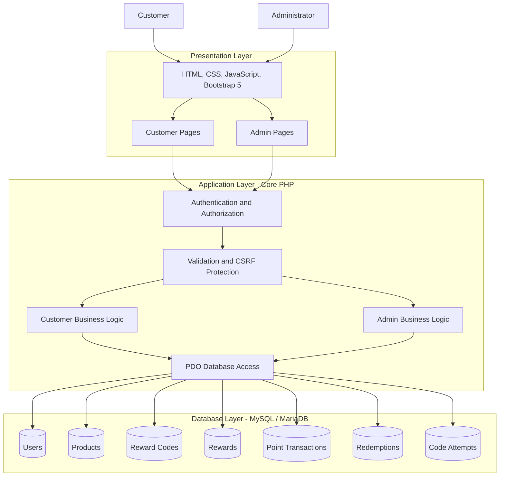

# System Architecture

## 1. Introduction

The Customer Loyalty Rewards System is a web-based application that allows customers to earn loyalty points by entering unique reward codes found inside product boxes. Customers can use their accumulated points to redeem available rewards.

Administrators manage products, rewards, reward-code generation, customers, and system activity.

The application follows a PHP-based server-side architecture with a MySQL/MariaDB relational database.

## 2. Technology Stack

| Layer | Technology |
|---|---|
| Frontend | HTML5, CSS3, JavaScript |
| UI Framework | Bootstrap 5 |
| Backend | Core PHP 8.1+ |
| Database | MySQL / MariaDB |
| Database Connectivity | PHP PDO |
| Local Development Server | XAMPP |
| Web Server | Apache |
| Version Control | Git and GitHub |

No PHP application framework or JavaScript frontend framework is required.

## 3. High-Level Architecture

The application follows a three-layer architecture:

1. **Presentation Layer:** Displays pages and forms to customers and administrators.
2. **Application Layer:** Handles authentication, authorization, validation, business rules, and application operations using PHP.
3. **Database Layer:** Stores users, products, reward codes, rewards, points transactions, redemptions, and code-attempt records.

### Architecture Diagram



## 4. Application Directory Structure

The main application is organized into configuration, shared components, public pages, and database files.

```text
customer-loyalty-rewards/
│
├── app/
│   ├── config/
│   │   ├── app.php
│   │   └── database.php
│   │
│   └── includes/
│       ├── auth.php
│       ├── csrf.php
│       ├── functions.php
│       ├── header.php
│       └── footer.php
│
├── database/
│   └── schema.sql
│
├── docs/
│   ├── setup.md
│   ├── assumptions.md
│   ├── ai_log.md
│   ├── manual_test_plan.md
│   └── architecture.md
│
├── public/
│   ├── admin/
│   │   ├── activity/
│   │   ├── codes/
│   │   ├── customers/
│   │   ├── products/
│   │   └── rewards/
│   │
│   ├── customer/
│   ├── assets/
│   │   └── css/
│   │       └── style.css
│   │
│   └── index.php
│
├── README.md
└── .env.example
```

*Note: This is a logical overview of the main project directories and files. Update it if the actual repository structure changes.*

## 5. Main Application Modules

### 5.1 Customer Module

The customer module provides the following functionality:

- Customer registration and login.
- Customer logout.
- Customer dashboard.
- Reward-code submission and validation.
- Points balance and transaction history.
- Available reward browsing.
- Reward redemption.
- Voucher display and redemption history.

### 5.2 Admin Module

The administrator module provides:

- Secure administrator login and logout.
- Admin dashboard.
- Product management.
- Reward management.
- Bulk reward-code generation.
- Generated-code result and CSV export.
- Customer listing and customer details.
- Activity monitoring.

### 5.3 Shared Application Components

Shared components provide functionality used across multiple pages:

- Database connection through PDO.
- Authentication and role-based authorization.
- Session management.
- CSRF token generation and verification.
- Common helper functions.
- Shared page header and footer.

## 6. Database Architecture

The system uses seven primary database tables.

| Table | Purpose |
|---|---|
| users | Stores administrator and customer accounts. |
| products | Stores product information and points per box. |
| reward_codes | Stores hashed reward codes, product association, points value, and redemption status. |
| rewards | Stores available loyalty rewards and required points. |
| point_transactions | Records points earned and points deducted. |
| redemptions | Stores customer reward redemptions and voucher information. |
| code_attempts | Records invalid, reused, and other unsuccessful reward-code attempts. |

### Database Relationships

- A product can have multiple generated reward codes.
- A customer can have multiple point transactions.
- A customer can have multiple reward redemptions.
- A reward can be associated with multiple customer redemptions.
- A reward code can be associated with one successful redemption transaction.
- A redemption record is linked to its customer and selected reward.

The database uses foreign keys, unique constraints, and indexes to maintain data integrity.

## 7. Important Data Flows

### 7.1 Customer Registration and Login

1. Customer opens the registration page.
2. Customer submits registration details.
3. The application validates the submitted information.
4. The password is securely hashed.
5. Customer information is saved in the users table.
6. During login, the submitted password is verified against the stored hash.
7. A successful login creates an authenticated session.

### 7.2 Reward-Code Generation

1. Administrator logs in.
2. Administrator selects an active product.
3. Administrator enters the required code quantity.
4. Application validates the product and quantity.
5. Unique random reward codes are generated.
6. Code hashes and associated points values are saved in the database.
7. Original generated codes are temporarily made available for the result and export workflow.

### 7.3 Reward-Code Validation and Points Awarding

1. Customer submits a reward code.
2. Application normalizes the submitted code.
3. The code is hashed for database lookup.
4. Application checks whether the code exists and is eligible.
5. The database transaction locks the relevant code record.
6. The application verifies that the code has not already been redeemed and its product is active.
7. The code is marked as redeemed.
8. A points transaction is recorded.
9. The transaction is committed and the updated points balance is reflected.

If validation fails, points are not awarded and the unsuccessful attempt is recorded where applicable.

### 7.4 Reward Redemption

1. Customer selects an active reward.
2. Application checks the customer's available points balance.
3. The relevant database records are locked within a transaction.
4. Application verifies that sufficient points are available.
5. A unique voucher code is generated.
6. A redemption record and corresponding points transaction are inserted.
7. The transaction is committed.
8. Customer can view the generated voucher and redemption history.

## 8. Points Management

The system maintains points using the point_transactions table.

- Earn transactions increase the customer's points.
- Redeem transactions decrease the customer's points.
- The available balance is calculated from the transaction ledger.

This provides a record of points activity instead of relying only on a manually updated balance.

## 9. Security Architecture

The application includes the following security measures:

1. **Password Security:** Passwords are stored using PHP password hashing functions.
2. **Prepared Statements:** PDO prepared statements are used for database operations.
3. **Session Security:** Secure session settings and session regeneration are used during authentication.
4. **Role-Based Access:** Customer and administrator pages enforce role checks.
5. **CSRF Protection:** Protected forms use CSRF tokens.
6. **Reward-Code Security:** Codes are randomly generated and stored as SHA-256 hashes.
7. **Duplicate Prevention:** Database unique constraints prevent duplicate code and transaction references.
8. **Transaction Safety:** Database transactions and row locking help prevent duplicate points awards and inconsistent redemptions.
9. **Output Escaping:** User-controlled output is escaped before being displayed.

## 10. Deployment Architecture

During local development, the application runs through XAMPP.

```text
User's Browser
      |
      | HTTP Request
      v
Apache Web Server (XAMPP)
      |
      v
PHP Application
      |
      | PDO
      v
MySQL / MariaDB Database
      |
      v
Response Returned to Browser
```

The application is accessed through the local XAMPP web server.

## 11. Conclusion

The Customer Loyalty Rewards System uses a modular PHP application structure with a relational database. Its architecture separates the user interface, application logic, and database responsibilities.

The design supports customer loyalty operations, administrator management, secure reward-code processing, points tracking, and reward redemption.
